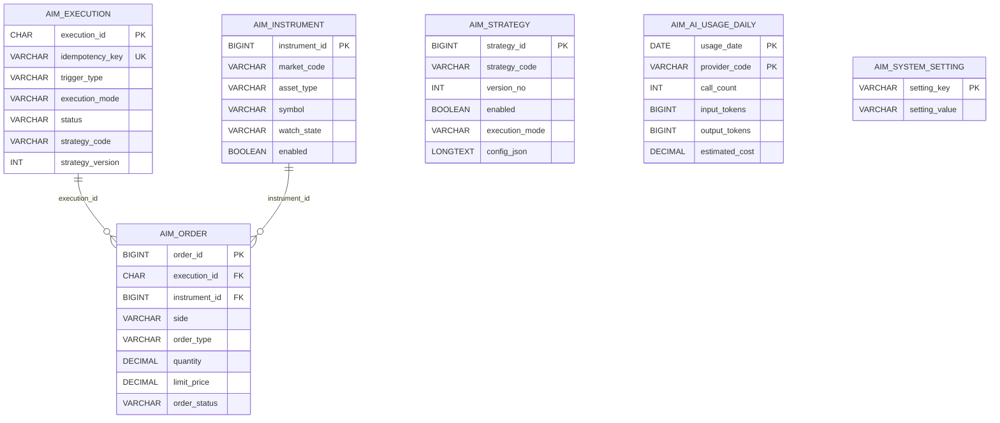

# 1단계 산출물: 핵심 데이터베이스 설계

- 상태: 설계 초안
- 기준 DDL: dbscript/01_schema_core.sql
- DBMS: MariaDB / InnoDB / utf8mb4
- 작성일: 2026-11-25

> 아직 MariaDB에 적용하거나 쿼리로 검증하지 않았습니다. MariaDB 버전을 확정한 뒤 CHECK 제약과 JSON_VALID 지원을 확인해야 합니다. 아래 명세는 현재 DDL 기준입니다.

## 1. 설계 원칙

- 투자 실행은 PAPER 모드를 기본으로 저장하고, 실주문은 별도 단계로 둡니다.
- 예약/수동 실행을 구별하며 멱등 키로 중복 실행을 막습니다.
- 전략은 코드별 버전을 보존하고 실행 당시 버전을 기록합니다.
- KR/US, STOCK/ETF, WATCH/ALLOW/EXCLUDE 값은 제한된 코드로 관리합니다.
- AI 사용량은 일자·제공자별로 기록해 월간 한도를 계산합니다.
- 시간은 밀리초 정밀도로 기록하며 DDL 세션 시간대를 UTC로 지정합니다.
- 이 스키마에는 체결·포지션·현금 스냅샷이 없습니다. 해당 모델은 후속 설계에서 추가합니다.

## 2. ERD

두 선은 실제 외래 키입니다. Execution은 Strategy를 FK로 참조하지 않고 코드/버전을 스냅샷으로 보관합니다. AI 집계와 설정 테이블은 독립입니다.

## 3. 테이블 명세

### 3.1 aim_strategy — 전략 버전

| 컬럼 | 타입 | NULL/기본값 | 키·규칙 | 용도 |
|---|---|---|---|---|
| strategy_id | BIGINT AUTO_INCREMENT | NOT NULL | PK | 버전 레코드 ID |
| strategy_code | VARCHAR(64) | NOT NULL | version_no와 UNIQUE | 전략 계열 식별자 |
| version_no | INT | NOT NULL | strategy_code와 UNIQUE | 전략 버전 |
| strategy_name | VARCHAR(120) | NOT NULL | — | 표시명 |
| enabled | BOOLEAN | NOT NULL / FALSE | enabled+execution_mode 인덱스 | 활성 여부 |
| execution_mode | VARCHAR(16) | NOT NULL / PAPER | CHECK PAPER/LIVE | 실행 모드 |
| config_json | LONGTEXT | NOT NULL | CHECK JSON_VALID | 조건과 위험 파라미터 |
| created_at | TIMESTAMP(3) | NOT NULL / CURRENT_TIMESTAMP | — | 생성 시각 |
| updated_at | TIMESTAMP(3) | NOT NULL / 자동 갱신 | — | 수정 시각 |

전략 코드별 단일 활성 버전은 DDL로 강제되지 않으므로 이후 서비스 트랜잭션이나 제약으로 보장해야 합니다.

### 3.2 aim_instrument — 투자 종목

| 컬럼 | 타입 | NULL/기본값 | 키·규칙 | 용도 |
|---|---|---|---|---|
| instrument_id | BIGINT AUTO_INCREMENT | NOT NULL | PK | 종목 ID |
| market_code | VARCHAR(8) | NOT NULL | CHECK KR/US, symbol과 UNIQUE | 시장 |
| asset_type | VARCHAR(12) | NOT NULL | CHECK STOCK/ETF | 자산 유형 |
| symbol | VARCHAR(32) | NOT NULL | market_code와 UNIQUE | 종목코드/티커 |
| display_name | VARCHAR(160) | NOT NULL | — | 표시명 |
| watch_state | VARCHAR(12) | NOT NULL / WATCH | CHECK WATCH/ALLOW/EXCLUDE | 관찰·허용·제외 상태 |
| enabled | BOOLEAN | NOT NULL / TRUE | watch_state+enabled 인덱스 | 레코드 사용 여부 |
| memo | VARCHAR(500) | NULL | — | 사용자 메모 |
| created_at, updated_at | TIMESTAMP(3) | NOT NULL / 현재 시각 | updated_at 자동 갱신 | 생성·수정 시각 |

### 3.3 aim_execution — 예약/수동 실행

| 컬럼 | 타입 | NULL/기본값 | 키·규칙 | 용도 |
|---|---|---|---|---|
| execution_id | CHAR(36) | NOT NULL | PK | UUID |
| idempotency_key | VARCHAR(100) | NOT NULL | UNIQUE | 중복 실행 방지 |
| trigger_type | VARCHAR(12) | NOT NULL | CHECK SCHEDULED/MANUAL | 실행 시작 경로 |
| execution_mode | VARCHAR(16) | NOT NULL / PAPER | CHECK PAPER/LIVE | 실행 모드 |
| status | VARCHAR(16) | NOT NULL | CHECK QUEUED/RUNNING/COMPLETED/STOPPED/FAILED | 진행 상태 |
| strategy_code, strategy_version | VARCHAR(64), INT | NULL | FK 없음 | 당시 전략 스냅샷 |
| started_at | TIMESTAMP(3) | NOT NULL / 현재 시각 | 시작 시각 인덱스 | 시작 시각 |
| finished_at | TIMESTAMP(3) | NULL | — | 종료 시각 |
| stop_reason | VARCHAR(500) | NULL | — | 중지·실패 원인 |
| summary_json | LONGTEXT | NULL | NULL 또는 JSON_VALID | 결과 요약 |

멱등 키는 현재 테이블 전역에서 유일합니다. 생성 규칙과 만료·보존 정책은 실행 서비스를 만들 때 확정합니다.

### 3.4 aim_order — 주문 기록

| 컬럼 | 타입 | NULL/기본값 | 키·규칙 | 용도 |
|---|---|---|---|---|
| order_id | BIGINT AUTO_INCREMENT | NOT NULL | PK | 주문 레코드 ID |
| execution_id | CHAR(36) | NOT NULL | FK → aim_execution | 실행 |
| instrument_id | BIGINT | NOT NULL | FK → aim_instrument | 종목 |
| side | VARCHAR(8) | NOT NULL | CHECK BUY/SELL | 매매 방향 |
| order_type | VARCHAR(12) | NOT NULL | CHECK MARKET/LIMIT | 주문 유형 |
| quantity | DECIMAL(24,8) | NOT NULL | CHECK > 0 | 주문 수량 |
| limit_price | DECIMAL(24,8) | NULL | NULL 또는 CHECK > 0 | 지정가 |
| currency_code | CHAR(3) | NOT NULL | — | 통화 코드 |
| order_status | VARCHAR(16) | NOT NULL | 상태 CHECK 미정의 | PAPER/증권사 주문 상태 |
| broker_order_id | VARCHAR(120) | NULL | — | 증권사 주문 ID |
| reason | VARCHAR(1000) | NULL | — | 판단 근거 |
| created_at, updated_at | TIMESTAMP(3) | NOT NULL / 현재 시각 | 종목+시각 인덱스, 수정 자동갱신 | 생성·수정 시각 |

주문 상태 코드, 체결/부분 체결 구조는 후속 주문 엔진 설계에서 구체화합니다.

### 3.5 aim_ai_usage_daily — AI 일별 사용량

| 컬럼 | 타입 | NULL/기본값 | 키·규칙 | 용도 |
|---|---|---|---|---|
| usage_date | DATE | NOT NULL | provider_code와 복합 PK | 집계 일자 |
| provider_code | VARCHAR(40) | NOT NULL | usage_date와 복합 PK | 제공자 코드 |
| call_count | INT UNSIGNED | NOT NULL / 0 | — | 호출 횟수 |
| input_tokens, output_tokens | BIGINT UNSIGNED | NOT NULL / 0 | — | 토큰 합계 |
| estimated_cost | DECIMAL(18,6) | NOT NULL / 0 | — | 추정 비용 |
| updated_at | TIMESTAMP(3) | NOT NULL / 현재 시각 | 변경 시 자동 갱신 | 갱신 시각 |

### 3.6 aim_system_setting — 개인 시스템 설정

| 컬럼 | 타입 | NULL/기본값 | 키·규칙 | 용도 |
|---|---|---|---|---|
| setting_key | VARCHAR(100) | NOT NULL | PK | 설정 코드 |
| setting_value | VARCHAR(1000) | NOT NULL | — | 문자열 설정 값 |
| description | VARCHAR(500) | NULL | — | 설명 |
| updated_at | TIMESTAMP(3) | NOT NULL / 현재 시각 | 변경 시 자동 갱신 | 변경 시각 |

초기 데이터는 execution.mode=PAPER, execution.enabled=false, ai.monthly_call_limit=0입니다. 비밀 키를 저장하는 테이블로 사용하지 않습니다.

## 4. 관계·삭제 정책

- aim_execution 1:N aim_order. 주문이 있으면 실행 레코드를 삭제할 수 없습니다.
- aim_instrument 1:N aim_order. 과거 주문이 있으면 종목 레코드를 삭제할 수 없습니다. EXCLUDE 또는 enabled=false로 보존합니다.
- aim_strategy ↔ aim_execution은 현재 FK가 없습니다. 실행 당시 코드·버전을 저장합니다.
- AI 사용량·시스템 설정은 독립 테이블입니다.
- FK에 ON DELETE CASCADE가 없어 매매 이력의 연쇄 삭제를 막습니다.

## 5. 인덱스

| 테이블 | 인덱스 | 목적 |
|---|---|---|
| aim_strategy | UNIQUE(strategy_code, version_no) | 버전 중복 방지 |
| aim_strategy | (enabled, execution_mode) | 활성 전략 조회 |
| aim_instrument | UNIQUE(market_code, symbol) | 시장별 심볼 중복 방지 |
| aim_instrument | (watch_state, enabled) | 허용/제외 종목 검색 |
| aim_execution | UNIQUE(idempotency_key) | 중복 실행 차단 |
| aim_execution | (started_at), (status, started_at) | 기간·상태별 이력 |
| aim_order | (execution_id), (instrument_id, created_at) | 실행·종목별 주문 |
| aim_ai_usage_daily | PK(usage_date, provider_code) | 일자/제공자 집계 |

## 6. 1단계 적용 절차 및 후속 결정

1. MariaDB 버전과 개발 DB 대상을 확인합니다.
2. 빈 stock DB에 dbscript/01_schema_core.sql을 검토 후 적용합니다.
3. 6개 테이블, 인덱스, FK, CHECK와 초기 PAPER 설정을 확인합니다.
4. 실제 적용 결과와 DB 버전을 기록하고 필요하면 DDL과 문서를 함께 수정합니다.

후속 확정 항목은 활성 전략 유일성, 주문 상태/체결 테이블, 포트폴리오 스냅샷, AI 비용 통화와 월간 집계 기준, 멱등 키 생성·보존 정책, 스키마 버전 관리 방식입니다.