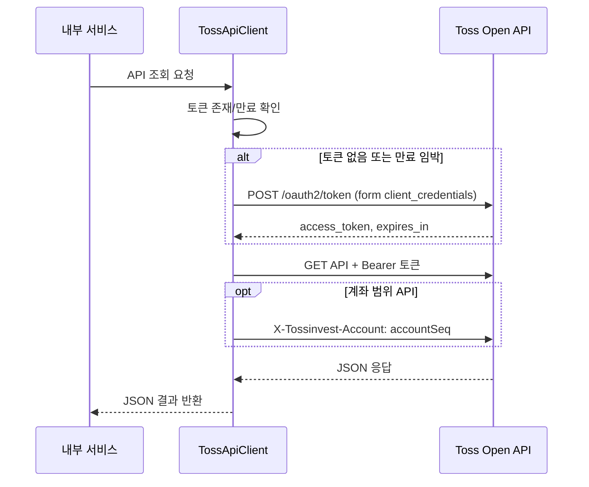

# 3단계 토스증권 API 연동 설계 및 구현 현황

## 목적과 범위

토스증권 Open API와 백엔드 간 연동 경계를 구현합니다. 1차 범위는 OAuth 인증 토큰, 국내·미국 현재가 조회, 본인 계좌 목록 및 보유 자산 조회입니다. 매매 주문·정정·취소 API는 포함하지 않습니다.

## 보안 원칙

- 앱키와 시크릿키는 `TOSS_CLIENT_ID`, `TOSS_CLIENT_SECRET` OS 환경변수로만 주입합니다.
- 설계 문서, 소스, 프론트엔드, 로그, 오류 응답에 인증 비밀값이나 토큰을 기록하지 않습니다.
- 계좌 API의 `X-Tossinvest-Account` 값은 계좌번호가 아니라 계좌 목록 응답의 숫자 `accountSeq`입니다.
- 토큰은 백엔드 프로세스 메모리에 캐시하고 만료 60초 전에 갱신합니다.
- 토스는 클라이언트당 유효 액세스 토큰 하나를 허용합니다. 동일 키를 여러 백엔드 인스턴스가 동시에 사용하면 안 됩니다.
- 브라우저에서 호출할 API 컨트롤러는 개인 접근 인증/접근 제어를 먼저 설계한 뒤 추가합니다.
- 조회 컨트롤러는 `Authorization: Bearer` 개인 토큰이 없거나 틀리면 차단합니다. 토큰 미설정 상태도 fail-closed로 처리합니다.

## 요청 흐름



## 구현 구성

| 구성요소 | 책임 |
|---|---|
| `TossApiProperties` | 활성화 여부, API URL, 앱키/시크릿키 설정 |
| `TossApiConfiguration` | 백엔드 전용 `RestClient`를 직접 생성하고 연결/응답 타임아웃 설정 |
| `TossApiClient` | OAuth 토큰 발급/메모리 캐시, Bearer 인증, 계좌 헤더, HTTP 오류 정규화 |
| `TossMarketDataService` | 심볼 검증과 현재가 조회 (`GET /api/v1/prices`, 최대 200개) |
| `TossAccountService` | 계좌 목록 (`GET /api/v1/accounts`) 및 보유 자산 (`GET /api/v1/holdings`) 조회 |
| `TossApiSmokeCheckRunner` | `TOSS_SMOKE_CHECK=true`일 때만 국내·미국 현재가 2건과 계좌 목록 1건 이상을 확인하고 행 개수만 표시 |
| `TossMarketController` | `/api/toss/**` 읽기 전용 시세·계좌·보유 조회 API; 응답은 공통 `ApiResponse`로 감쌈 |
| `TossApiAccessInterceptor` | 일정 시간 비교로 개인 Bearer 토큰 검증, 미설정 503 / 불일치 401 |
| `TossRequestPacer` | 한 프로세스의 토큰 발급과 조회 호출을 기본 500ms 간격으로 직렬화 |
| `TossApiException` | 상태 코드와 안전한 내부 오류 전달, 외부 오류 본문 비노출 |

현재 점검기는 국내 `005930`, 미국 `AAPL` 현재가 각각 한 건(합계 2건)과 계좌 목록 한 건 이상을 확인해야 성공 처리합니다. 응답의 실제 시세와 계좌 식별 정보는 출력하지 않습니다.

### 내부 응답 모델

- 현재가 `TossPriceQuote`: `symbol`, 원문 시각 문자열 `timestamp`, 정밀도를 유지하는 `BigDecimal lastPrice`, `currency`로 변환합니다.
- 계좌 `TossAccountSummary`: `accountSeq`, `accountType`, 마스킹된 계좌번호만 반환합니다. 원 계좌번호는 API 응답에서 제거합니다.
- 보유 `GET /accounts/{accountSeq}/holdings`: 실제 연결 계좌에서 보유 항목이 없어 `items`가 빈 배열임을 확인했습니다. 집계 응답은 원 구조를 보존하고, 보유 항목 DTO는 실제 행을 확인하기 전까지 추측해 만들지 않습니다.
- 시세 API는 요청 종목의 현재 값만 응답하고 시장 전체 시세를 DB에 복제하지 않습니다. PAPER 주문을 기록하는 5단계에서 판단에 사용한 선택 종목·가격·시각을 실행 근거로 저장합니다.

## 설정

`application.yml`에는 환경변수 이름만 선언하고 기본은 비활성화합니다. 로컬 프로파일에서는 프로젝트 루트의 Git 제외 파일 `.env.properties`를 선택적으로 가져오므로 개인 인증값을 로컬에서 보관할 수 있습니다.

```yaml
stock:
  api:
    access-token: ${STOCK_API_ACCESS_TOKEN:}
  toss:
    enabled: ${TOSS_API_ENABLED:false}
    smoke-check: ${TOSS_SMOKE_CHECK:false}
    base-url: ${TOSS_API_BASE_URL:https://openapi.tossinvest.com}
    client-id: ${TOSS_CLIENT_ID:}
    client-secret: ${TOSS_CLIENT_SECRET:}
    min-request-interval-millis: ${TOSS_MIN_REQUEST_INTERVAL_MS:500}
```

로컬에서는 `.env.properties`에 입력된 앱키·시크릿키와 선택적인 `STOCK_API_ACCESS_TOKEN`을 `protect-local-secrets.ps1`로 Windows 사용자 DPAPI 암호문으로 변환합니다. `.gitignore`의 `.env.*` 패턴이 이 파일을 저장소에서 제외합니다. 서버는 `run-local.ps1`로 실행하며, 이 스크립트는 실행 중에만 값을 복호화해 Java 프로세스 환경변수로 전달하고 종료 시 현재 PowerShell의 임시 값을 복구합니다. 다른 Windows 계정/PC에서는 암호문을 복호화할 수 없습니다. 실제 키와 접근 토큰은 문서·커밋·채팅에 적지 않습니다. 접근 토큰 미설정 상태에서는 `/api/toss/**`를 503으로 차단하고, 토큰 불일치는 401로 응답합니다. HTTP 연결 타임아웃은 5초, 응답 읽기 타임아웃은 10초입니다. DTO/JSON 처리는 Spring Boot 4 기본 Jackson 3 의존성을 사용합니다.

개인 접근 토큰은 32바이트 이상의 난수로 생성해 `.env.properties`에 `STOCK_API_ACCESS_TOKEN=...`으로 입력한 후 암호화 스크립트를 실행합니다. 프론트엔드 요청은 `Authorization: Bearer <token>` 헤더를 사용해야 하며, URL 쿼리나 로그에 토큰을 넣지 않습니다. 배포 시에는 DPAPI 파일을 복사하지 말고 배포 환경의 비밀 저장소/환경변수에 주입합니다.

연결 확인은 `TOSS_SMOKE_CHECK=true`를 명시한 경우에만 애플리케이션 시작 시 수행합니다. 기본 설정에서는 외부 호출을 하지 않습니다. 확인 과정은 `005930`과 `AAPL` 현재가 및 계좌 목록을 읽고, 실제 응답 필드나 계좌번호는 출력하지 않습니다. HTTP 연결 제한은 연결 5초, 응답 읽기 10초로 둡니다.

## 오류 처리

| HTTP 상태 | 내부 코드 | 처리 |
|---|---|---|
| 400 | `TOSS_BAD_REQUEST` | 입력값과 최신 API 스키마 확인 |
| 401 | `TOSS_UNAUTHORIZED` | 키 유효성 및 토큰 발급 확인 |
| 403 | `TOSS_IP_NOT_ALLOWED` | 실제 요청 서버의 공인 출구 IP 등록 확인 |
| 404 | `TOSS_RESOURCE_NOT_FOUND` | 요청 경로 또는 심볼 확인 |
| 429 | `TOSS_RATE_LIMITED` | 호출을 즉시 반복하지 말고 호출량과 간격 확인 |
| 5xx·네트워크 실패 | `TOSS_SERVER_ERROR` / `TOSS_NETWORK_ERROR` | 비밀값과 응답 본문을 기록하지 않고 실패 처리 |

프로세스 내 모든 토스 요청은 기본 500ms 간격으로 순차화합니다(`TOSS_MIN_REQUEST_INTERVAL_MS`로 조절 가능). 외부 429 응답은 호출자에게 429와 `Retry-After` 헤더(토스가 제공한 경우)를 반환합니다. 자동 재시도는 하지 않습니다. 자동 실행 중지 연동과 계정별 실제 한도에 맞춘 호출량 정책은 PAPER 실행 흐름과 운영 조건을 확정하는 단계에서 구현합니다.

## 구현 범위와 남은 작업

### 구현 완료 범위

- 환경변수 기반 토스 API 활성화 및 자격증명 설정
- Client Credentials 토큰 발급과 프로세스 내 만료 전 캐시
- 국내·미국 심볼 현재가 조회 및 200개 상한 검증
- 계좌 목록 및 `accountSeq` 기반 보유 자산 조회
- 인증·허용 IP·한도·네트워크 오류를 비밀값 없이 정규화
- 인증이 적용된 읽기 전용 API (`GET /api/toss/prices`, `/accounts`, `/accounts/{accountSeq}/holdings`)
- 요청별 최소 간격 및 429/`Retry-After` 안전 처리
- 로컬 개인 접근 토큰 DPAPI 보관 및 Bearer 검증
- 현재가/계좌 목록 내부 DTO 변환과 계좌번호 마스킹

### 후속 단계 및 조건부 보완

- 보유 종목이 생기면 `items` 응답 필드를 확인해 보유 항목 DTO 추가
- 자동 실행 연동 429 백오프·중지 정책은 실행 경로가 생기는 6단계에서 연결
- 브라우저 Bearer 호출은 프론트 API 연동 7단계에서 구현
- 웹소켓, 주문, PAPER 체결 처리

3단계 읽기 전용 연결 점검 결과: 인증 없는 요청은 401, DPAPI 토큰 인증 시 현재가 2건·계좌 1건·보유 조회 성공을 확인했습니다. 실제 계좌번호·시세 값·잔액은 점검 출력에 기록하지 않았고 주문 API는 호출하지 않았습니다.

## 공식 API 참고

- [OAuth 인증 가이드](https://developers.tossinvest.com/docs/auth)
- [Market Data 가이드](https://developers.tossinvest.com/docs/market-data)
- [계좌 이벤트의 `accountSeq` 안내](https://developers.tossinvest.com/docs/order-event)
- [Open API 이용 약관](https://home.tossinvest.com/ko/terms/v2?id=752)
